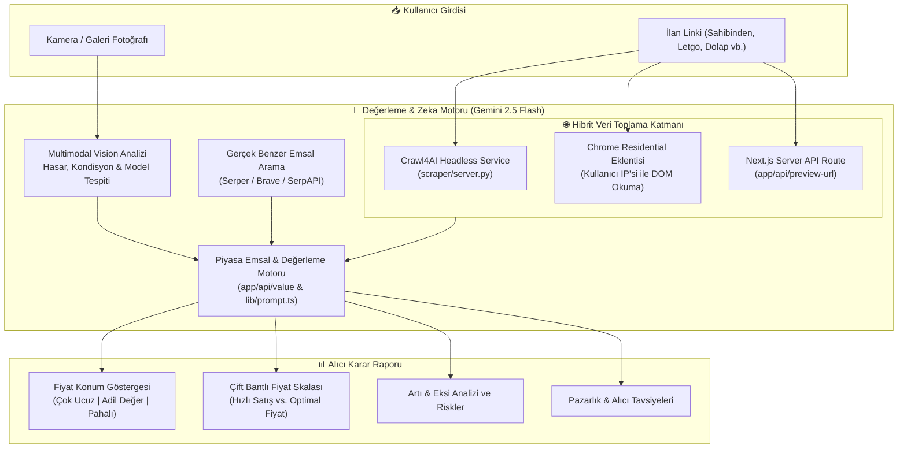

# 🛍️ Almadan Önce (Bu Ne Kadar Eder?) — AI Alışveriş & Piyasa Değerleme Asistanı

<div align="center">

[-black.svg?logo=next.js&logoColor=white)](https://nextjs.org/)
[](https://www.typescriptlang.org/)
[](https://tailwindcss.com/)
[-8E75B2.svg?logo=google&logoColor=white)](https://aistudio.google.com/)
[](https://developer.chrome.com/docs/extensions/)
[](https://crawl4ai.com/)
[](LICENSE)

**İkinci el ilan linkini yapıştırın veya fotoğrafını yükleyin; Google Gemini Vision ve gerçek zamanlı web tarayıcı motoru ürünü tanısın, adil piyasa değerini hesaplasın, benzer emsalleri bulsun ve alıcıya özel risk/pazarlık tavsiyelerini sunsun.**

[Öne Çıkan Özellikler](#-öne-çıkan-özellikler) • [Sistem Mimarisi](#-sistem-mimarisi) • [Çift Giriş Modu](#-çift-giriş-modu-link--fotoğraf) • [Chrome Eklentisi](#-chrome-eklentisi-manifest-v3) • [Kurulum](#-kurulum-ve-çalıştırma) • [Ortam Değişkenleri](#-ortam-değişkenleri)

</div>

---

## 📌 Genel Bakış

İkinci el piyasasında (araç, elektronik, telefon, bilgisayar, saat vb.) alıcıların karşılaştığı en büyük sorunlar:
- **Şişirilmiş Fiyatlar:** İlan sahibinin istediği fiyat piyasa normlarının üzerinde mi, adil mi yoksa fırsat mı?
- **Gizli Kusurlar & Riskler:** İlan açıklamasında ve fotoğraflarında gözden kaçan kronik arızalar veya şüpheli ifadeler var mı?
- **Bot Korumalı Siteler (Akamai / DataDome):** Sahibinden, Letgo, Dolap gibi sitelerin sunucu taraflı kazınmaya karşı uyguladığı korumalar.

**Almadan Önce**, hem **doğrudan link analizi** (hibrit headless scraper ve Chrome residential eklentisiyle) hem de **görsel/fotoğraf analizi** (Gemini 2.5 Flash Vision) ile bu süreci saniyeler içinde tarafsız ve veri odaklı bir alıcı raporuna dönüştürür.

---

## 🏗️ Sistem Mimarisi



---

## 🚀 Öne Çıkan Özellikler

- 🔗 **Evrensel İlan Link Analizi:** Otomobil, motosiklet, iPhone, MacBook, fotoğraf makinesi veya mobilya; herhangi bir ikinci el ilan linkini doğrudan çözümler.
- 📷 **Yapay Zeka Destekli Görsel Tarama:** Satışta olan ürünün fotoğrafını yükleyin; Gemini Vision çizikleri, model yılını, yıpranma payını tespit edip piyasaya göre fiyatlasın.
- 🎯 **Adil Değer Aralığı & Fiyat Termometresi:** İstenen fiyatın güncel Türkiye ikinci el piyasasına göre nerede durduğunu yüzdesel farkla gösterir.
- 🔍 **Gerçek Tıklanabilir Emsaller:** Pazardaki benzer ürünlerin güncel fiyatlarını ve doğrudan linklerini listeler.
- 🛡️ **Risk & Kronik Sorun Uyarısı:** İlgili modelin bilinen kronik arızalarını (ör. araçlarda DSG şanzıman, telefonlarda pil sağlığı/ekran değişimi) önceden hatırlatır.
- 🧩 **Chrome Eklentisi:** Bot korumalı platformlarda tek tıkla sayfa içeriğini güvenli bir şekilde analiz motoruna aktarır.

---

## 🧩 Chrome Eklentisi (Manifest V3)

Bot korumalı (Akamai/DataDome) pazaryerlerinde sunucu kısıtlamalarına takılmadan analiz yapabilmek için hafif bir Chrome eklentisi geliştirilmiştir:

- **Konum:** [`extension/`](extension/)
- **Özellikler:**
  - İlan sayfasındayken tek tıkla başlık, fiyat, teknik özellikler ve fotoğrafları çeker.
  - Web uygulamasına JSON formatında aktararak anında analiz başlatır.
  - Harici proxy veya web-unlocker masrafını ortadan kaldırır (Kullanıcının kendi tarayıcı oturumunu kullanır).

---

## 📂 Proje Yapısı

```ascii
bu-ne-kadar-eder/
├── app/                         # Next.js 14 App Router
│   ├── api/                     # Sunucu taraflı REST uç noktaları
│   │   ├── analyze/             # Fotoğraf & görsel analiz rotası
│   │   ├── ingest/              # Eklenti veri alım uç noktası
│   │   ├── market/              # Benzer pazar emsalleri servisi
│   │   ├── preview-url/         # Link önizleme ve metadata kazıyıcı
│   │   └── value/               # Gemini değerleme ve fiyat hesaplayıcı
│   ├── globals.css              # Tailwind CSS global stilleri
│   ├── layout.tsx               # Ana layout
│   └── page.tsx                 # İnteraktif ana ekran (Link + Fotoğraf + Rapor)
├── extension/                   # Chrome Eklentisi (Manifest V3)
│   ├── manifest.json            # Eklenti izinleri ve tanımları
│   ├── popup.html               # Eklenti arayüzü
│   └── popup.js                 # DOM ayrıştırıcı ve API aktarıcı
├── lib/                         # Çekirdek yardımcı fonksiyonlar ve tipler
│   ├── platforms.ts             # İlan metni oluşturucu ve şablonlar
│   ├── prompt.ts                # Gemini sistem promptları ve şema tanımları
│   ├── ratelimit.ts             # IP bazlı günlük kullanım limitleyici
│   └── types.ts                 # TypeScript arayüz ve tip tanımları
├── scraper/                     # Python Crawl4AI headless tarayıcı servisi
│   ├── requirements.txt         # Scraper bağımlılıkları
│   └── server.py                # FastAPI tabanlı headless browser motoru
├── .env.example                 # Güvenli ortam değişkenleri şablonu
├── tailwind.config.ts           # Tailwind CSS yapılandırması
└── package.json                 # Node bağımlılıkları
```

---

## 💻 Kurulum ve Çalıştırma

### 1. Gereksinimler
- Node.js 18.18+ veya 20+
- (Opsiyonel) Python 3.10+ (Yerel headless scraper için)

### 2. Web Uygulamasını Başlatma

```bash
# Repoyu klonlayın
git clone https://github.com/huseyin-yigit-ulker/bu-ne-kadar-eder.git
cd bu-ne-kadar-eder

# Bağımlılıkları yükleyin
npm install

# Ortam değişkenlerini ayarlayın
cp .env.example .env.local
```

`.env.local` dosyasını açıp [Google AI Studio](https://aistudio.google.com/apikey) üzerinden aldığınız ücretsiz API anahtarınızı girin:

```env
GEMINI_API_KEY=AIzaSy...
GEMINI_MODEL=gemini-2.5-flash
FREE_DAILY_LIMIT=10
```

Geliştirme sunucusunu başlatın:

```bash
npm run dev
```

Uygulama `http://localhost:3000` adresinde çalışacaktır.

---

### 3. (Opsiyonel) Python Headless Scraper Servisini Çalıştırma

Sunucu tarafında bot korumasız siteleri doğrudan headless tarayıcıyla çekmek için:

```bash
cd scraper
python3 -m venv venv
source venv/bin/activate
pip install -r requirements.txt
playwright install chromium
python server.py
# http://localhost:8000 üzerinde aktif
```

---

### 4. Chrome Eklentisini Yükleme

1. Chrome'da `chrome://extensions/` adresine gidin.
2. Sağ üstten **Geliştirici Modu (Developer mode)** anahtarını açın.
3. **Paketlenmemiş öğe yükle (Load unpacked)** butonuna tıklayın ve repodaki `extension/` klasörünü seçin.

---

## ⚖️ Lisans

Bu proje [MIT Lisansı](LICENSE) kapsamında açık kaynak olarak sunulmuştur.

---

<div align="center">
Geliştirici: <a href="https://github.com/huseyin-yigit-ulker">Hüseyin Yiğit Ülker</a>
</div>
